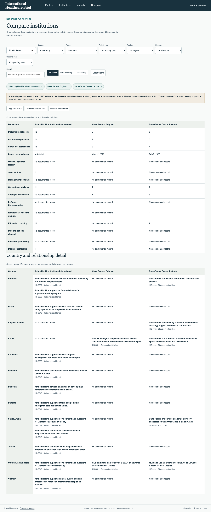
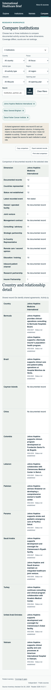

# PR #2 release verification — October 22, 2026

This revision combines PR #2 `a3fb3745a6a7658292b6d9b9aecc3c42c9b572b6` with main after PR #3 `e796227309268c0b34a1e18fbc177219fd9a6740`, preserving both sets of changes and the mobile-focus/archive-country fixes. Comparison headers now override the global no-wrap rule with `.comparison-table th { white-space: normal; }`.

All 24 generated projections agree; 27 Python and 39 JavaScript tests passed. Public static packaging passed. The broader local integration journeys are recorded in the root VERIFICATION.md; source files were verified against that tested integration before preparing this revision.

## Focused browser verification

Chrome exercised the final reader assets at 1440×1024, 390×844 and 320px, plus print media at A4-equivalent width. Both comparison tables were checked with Johns Hopkins Medicine International, Mass General Brigham and Dana-Farber Cancer Institute. Every institution/dimension header wraps inside its column. The page has no horizontal overflow; the narrow comparison table retains its own horizontal scrolling.

The actual comparison CSV download contains shared IHB-0081 once, while the comparison displays it in both participating columns. An actual PDF was generated. Mobile Map selection dismissal restores keyboard focus to the selected pin. Cleveland Clinic + Europe + T11 yields the one expected insurer record. No application errors were observed.

- [Browser measurements](browser-results.json)
- [Generated comparison PDF](comparison.pdf)
- [Desktop screenshot](comparison-desktop.png)
- [Mobile screenshot](comparison-mobile.png)

These are local browser observations, not deployment evidence. Physical touchscreen/pinch, full screen-reader behavior, other browser engines and physical printing remain unverified. CI validates the exact pushed revision; the Pages workflow records deployment independently after merging. Inventory and verification dates remain October 20, 2026; no new source scan or edition is claimed.
